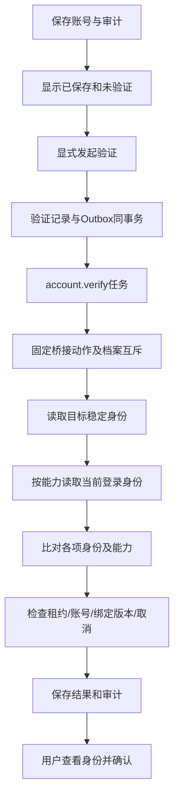

# CHANGE-020 运营账号验证与状态反馈规划

2026-10-27；Codex。本文为建议方案，实施及验收事实仅维护于[开发进度](../tracking/开发进度.md)，交接见[开发日志](../tracking/开发日志.md)。本轮交付规划，不代表账号验证已经实现或接通。

基线：`/Users/junlong/projects/social-mdeida-ops-platform`，`codex/s9-acceptance`，`9ae84f7` 加既有及并行未提交修改。遵循[业务状态与权限](../yoyo-workbench-v1.0/03-业务状态与权限.md)、[数据模型](../yoyo-workbench-v1.0/05-数据模型与字典.md)和[外部依赖](../yoyo-workbench-v1.0/08-自动采集与外部依赖.md)。不引入工作台内部登录，不改实际制作/人工发布范围。

## 1. 要解决的问题与完成后的用户答案

用户在工作区设置添加运营账号后，应能直接回答四个问题：信息存好了没有；平台上的账号是否与填写身份一致；当前浏览器登录的是不是这个账号；系统具体能读取哪些内容、上次什么时候验证。

不能用一个“有效”绿标概括以上结论。公开主页可读不能证明登录身份或账号控制权；登录身份一致不能证明后台指标接口可用；手动确认也不能替代平台读取证据。

目标体验：填写身份 → 保存成功且状态明确 → 手动发起只读验证 → 展示平台返回的身份与比对结果 → 用户确认这是自己要管理的账号 → 按真实证据列出可用范围。每个失败都说明原因和下一步，刷新或关闭页面不丢结果。

默认建议：先支持小红书完整身份核验；微博保留登记能力，在适配器真实通过前明确显示“在线验证暂未支持”。首版产品基线为单小红书运营账号，现有平台枚举同时允许微博；不能因已有微博热榜接口而声称微博账号验证可用。

## 2. 当前实现与可复用边界

| 已核对的产物 | 当前事实 | 本次规划的复用方式 |
|---|---|---|
| [账号页面](../../apps/web/src/main.tsx) `Accounts` | 创建填平台/内部ID/名称/时区；保存后关闭抽屉并刷新列表；表格只有名称/平台/时区/操作；编辑不显示原内部ID | 复用页面和抽屉，补保存提示、身份展示和验证区 |
| [账号命令](../../apps/api/src/commands.ts) `createAccount` / `patchAccount` | 创建仅校验本地输入、入库及审计；编辑仅名称/时区；无平台请求 | 保留登记行为，新增独立验证命令，不在数据库事务中访问平台 |
| [基础表](../../packages/db/migrations/001-foundation.sql) `accounts` | 已有内部ID、展示号、profile_url、版本；平台+内部ID在工作区唯一 | 保留UUID和身份唯一约束，新增验证信息，不另造平台账号表 |
| [浏览器桥接](../../tools/s3/source-bridge.mjs) | 仅有鉴权后的 `/health`、`/collect`；按profile互斥、有界输入/子进程时间 | 新增固定验证动作，与采集共享profile互斥；健康检查不当作平台验证 |
| [小红书采集器](../../tools/s3/xhs-collector.mjs) | 支持关键词和参考账号公开内容；`own_account_metrics:false` | 复用浏览器档案、错误分类和读取基础，不复用采集结果推断账号归属 |
| [历史稳定身份探测](../../tools/s0/verify-backend-identity.mjs)、[样本报告](../evidence/s0/数据与OCR验证.md) | 曾真实核对“我”链接、稳定主页路径、后台展示号；属于历史独立探测 | 将比对方法转为受约束适配器并重新验证；历史结果不灌成当前状态 |
| [任务底座](../../packages/domain/src/jobs.ts)、[worker注册](../../apps/worker/src/main.ts) | 已有Outbox/Job、租约、取消、结果事务及守卫；默认失败有自动重试 | 复用任务链路；验证业务失败需显式分类，不能沿用无限恢复假设 |
| [任务白名单](../../packages/db/migrations/026-retire-cancelled-workflows.sql)、[契约扩展源](../../tools/s1/contract-extension.py) | 新任务必须被数据库函数允许，契约从源文件生成 | 同步允许 `account.verify`，同步接口Schema/生成类型/样例 |

本轮依据本地源码和历史证据提出方案，没有查询平台当前接口文档或执行真实平台请求。平台可读取哪些身份字段、是否需要当前会话、头像链接如何处理，都在后续能力探测中确认，不把候选接口当已可用接口。

## 3. 方案比较与推荐

| 路径 | 内容 | 优点 | 局限与风险 | 工作量级 |
|---|---|---|---|---|
| A 最小修正 | 仅保存提示、完整身份展示、未验证标签、平台主页入口和人工核对说明 | 改动少，立即消除保存与授权混淆；不依赖平台 | 仍由用户人工检查，无法识别登录错号 | 小 |
| B 分层只读验证，推荐 | A + 复用桥接读取目标身份/当前登录身份 + 后台验证记录 + 用户确认 + 独立能力展示 | 直接解决账号有效性问题，沿用现有本地运行方式，有失败/历史证据 | 需要验证读取方法，会遇到登录/限流/页面变化 | 中 |
| C 完整平台授权中心 | 官方授权协议、令牌生命周期、跨平台权限管理与自动同步 | 若平台实际提供所需权限，可建立更完整长期接入 | 可用接口/资质/权限/成本未确认；超出当前单实例身份核验需求 | 大，待调研 |

建议以B作为详细实施方向，A作为首个独立可交付切片。C保留为未来接入选择；本轮不承诺OAuth或后台数据权限。以上均为建议，未把方案选择或产品开发记作用户已批准。

## 4. 页面与交互

### 4.1 运营账号列表

列表列为：账号（平台昵称/本地备注）、平台、账号标识（展示号+内部ID）、身份核验、登录核验、最近验证、操作。时区放详情，窄屏用上下排列的账号信息或可键盘滚动表格，避免同时堆满八个密集列。

列表入口固定为“查看 / 编辑”“验证账号”；已运行时显示实际排队/验证中并提供任务入口。验证按钮写“验证账号”，与来源页“验证恢复”明确区分。页头常驻说明：“保存仅登记账号；身份验证与平台登录状态分别显示。”

新旧账号均展示稳定内部ID，详情提供复制按钮；列表可截断但详情完整。平台昵称与用户填写的本地备注分开，不用平台返回值覆盖备注。无头像时使用文字占位，不能依靠头像识别身份。

### 4.2 添加与保存

1. 选择平台，优先输入“账号主页链接或平台内部ID”，给出该平台已验证支持的输入形式与获取说明。昵称、展示号、笔记链接不能被静默当成内部ID。
2. 输入规范化在本地完成：只接受明确的平台官方主机和主页路径，从已知主页路径提取内部ID。首版不在线展开短链；提示用户打开后复制完整主页链接。纯展示号不能可靠解析时明确提示。
3. 填写“本地备注名称”和时区；平台身份字段另列。保存按钮为“保存账号”。另提供“保存并验证”，两者的持久化和远端任务各有结果。
4. 保存成功保留可见状态提示：“账号已保存，尚未验证平台身份”，随后打开详情并提供“验证账号”。刷新后列表仍有账号才是持久化证据。
5. “保存并验证”严格先保存、再提交验证。提交验证失败显示“账号已保存，验证未提交，可重试”，不得说保存失败；重试复用原账号，不重复创建。
6. 重复身份返回可操作冲突，指向当前工作区已存在账号；普通数据库/网络失败保留输入，不显示成功。

新建身份格式校验以适配器已验证规则为准。现有小红书参考账号代码使用24位公开主页ID，但这不是对所有平台/身份类型的通用规则；微博规则在探测前不能照搬。

### 4.3 详情与验证结果

详情按以下顺序展示：

```text
运营账号                                  查看平台主页
本地备注：示例运营号（布局示意）
平台返回昵称：示例昵称  展示号：平台实际返回时显示
平台：小红书   内部ID：完整稳定ID   时区：Asia/Shanghai

登记：已保存
身份核验：公开身份匹配 / 待验证 / 本次无法确认
登录核验：当前登录身份一致 / 当前登录其他账号 / 需要登录 / 未支持
最近检查：实际时间   最近身份匹配：实际时间或无
账号确认：待你确认 / 已确认管理此账号（仅人工声明）

可用范围：公开身份、当前会话身份、后台指标分别列出证据
本次说明：可读范围、缺失字段、错误和建议动作

[验证账号]  [确认管理此账号]  [查看验证记录]
```

以上只为文本线框，未连接API，没有真实身份数据。用户确认按钮仅在获得新鲜、未过期且与当前绑定一致的目标身份匹配结果后可用；确认文案为“我已核对以上账号，确认将它用于本工作区运营”。该声明不证明法定所有权，不替代平台授权。

公开身份匹配但登录身份不同：显示两项独立结果，提示去对应浏览器档案切换登录；不自动把已保存账号改为当前登录者。用户仍可在明确告知范围后确认管理这个目标账号，但依赖该登录身份的读取不可用。

### 4.4 异步过程与异常

- 提交后显示“验证已提交”，按实际状态显示排队/运行/终态；不显示虚构百分比。关闭抽屉不取消后台任务，重新打开/刷新能恢复记录。
- 仅活动任务轮询，建议2秒一次，读取失败后退避到5–15秒并提示可重试；终态及页面离开停止轮询。可复用采集进度的交互方式，不让账号任务混入采集条数统计。
- 运行失败保留账号和最近历史成功；同时醒目展示本次失败原因。不能只露出历史绿标掩盖新失败。
- 登录失效提示“在已绑定浏览器档案登录后重新验证”；验证码/访问拒绝提示人工处理并停止该任务；限流显示重试时间；浏览器未启动/档案缺失提供对应运行入口或说明。
- 409并发冲突保留编辑内容，说明哪个绑定或版本变化导致重试；验证失败不清空本地备注，不跳回空列表。
- 状态文字可被辅助技术读取；按钮有忙碌态，焦点与抽屉一致；320px及键盘操作可完成基本核验。

## 5. 状态模型与判定规则

### 5.1 独立维度

| 维度 | 建议值 | 含义 |
|---|---|---|
| 账号登记 | 存在/不存在 | 数据库事务是否成功，与远端读取无关 |
| 验证任务 | 复用Job `queued/running/succeeded/partial/failed/cancelled` | 表示本次任务阶段，不直接表示账号真假 |
| 目标公开身份 | `unverified / matched / inconclusive / not_found` | 必须用返回稳定ID比对目标ID；明确不存在需要可靠的平台证据 |
| 登录身份 | `unknown / matched / mismatched / auth_required / unsupported` | 是当前指定档案在该观察时点的身份，不是永久授权 |
| 人工管理确认 | `pending / confirmed` | 针对具体目标身份与核验记录的人工声明 |
| 读取能力 | 每项 `unknown / supported / unsupported`，附检查时间/证据 | 区分公开资料、当前登录身份、后台指标；未测为unknown |
| 时效 | 根据观察时间/绑定版本派生 `fresh / stale` | 默认24小时仅作复核提醒建议，不视为平台会话保证 |

任务执行成功但返回身份与目标不一致，业务结果必须标为不匹配/失败，不能向用户显示“账号验证成功”。公开身份匹配但登录未测或不支持，可将整体任务记为partial并说明已验证范围；前端按各项结果展示，不根据HTTP 200/202推断有效。

### 5.2 页面主结论

| 条件 | 显示与允许动作 |
|---|---|
| 已保存，无验证 | “已保存 · 身份未验证”，可编辑、验证、手动核对 |
| 公开稳定ID匹配，待人工确认 | “平台身份已匹配 · 待确认管理账号” |
| 公开匹配，人工已确认，登录匹配 | “身份已核验；最近登录身份一致”，列出时间和能力 |
| 公开匹配，登录未支持/未登录 | “公开身份已核验；登录身份未确认/需登录”，不能声称后台可读 |
| 公开匹配，登录为其他ID | “公开身份已核验；当前登录账号不一致”，禁止使用该绑定读取目标私有后台 |
| 超时/浏览器不可用/被拦截 | “本次无法确认”，保留带时间的历史结果；不能显示账号不存在 |
| 可靠明确不存在 | “平台返回账号不可用”，显示观察时点；不删除本地账号或历史数据 |
| 绑定变更或超过复核时间 | “需要重新验证”，历史结果仅供查阅 |

匹配必须依据相同身份命名空间的稳定平台ID。昵称、头像相似、展示号看起来相同、搜索命中、热榜能读、访问返回200、笔记列表为空，都不能单独构成匹配或不存在判据。

### 5.3 业务限制边界

- 本次状态首先用于准确反馈，不给现有手工登记、历史指标、选题生成增加全面硬门禁。旧账号仍可读取历史、手工导入和人工核对；未验证状态可给可关闭的明确提醒。
- 后续任何依赖登录态的账号私有读取，都必须在服务端校验当前绑定身份与目标一致、能力符合且证据未失效；前端标签不能当授权凭据。
- 验证不导入粉丝/阅读等指标，不生成复盘，不触发来源采集/模型调用/自动发布。人工导入继续遵循原身份及行确认规则。
- 仅修改本地备注或时区不使稳定身份结果失效；替换档案引用或身份相关绑定须增加独立版本并使登录/能力确认失效。当前目标内部ID继续只读，不能普通编辑换号。

## 6. 技术设计

### 6.1 数据与迁移

保留 `accounts` 的UUID、内部ID唯一约束及历史引用；新增一份账号验证摘要和不可变尝试记录即可，不建设通用连接中心。

建议数据（尝试过程允许更新，终态身份观察与结果保留不可变历史）：

- `accounts`：可选 `browser_profile_ref`（本机配置引用，非Cookie/磁盘任意路径）、`identity_binding_version`（初始1）、`confirmed_verification_id`、`confirmed_at`；已存在的 `display_handle/profile_url` 可存已验证规范身份信息。平台昵称/头像等返回资料保存在核验结果中，不覆盖 `name`。
- `account_verifications`：`id/workspace_id/account_id/job_id`、`binding_version`、`requested_by/requested_at/started_at/finished_at`、请求指纹、期望身份摘要、身份/登录各项结果、能力与观察时间、结构化错误、适配器版本、脱敏证据引用/哈希。只存白名单字段，限制结果体积。
- 原始响应/截图仅在必要时保存至受限证据位置，记录期限；产品公共响应/审计不透传Cookie、令牌、签名链接、私有后台原文或不必要个人信息。头像不是成功判据，无法安全处理时用文本占位。
- 所有新外键带工作区/账号范围约束；验证列表按 `(workspace_id,account_id,requested_at,id)` 排序索引；运行中的同账号/绑定通过事务锁和运行记录约束防止重复提交。

展示摘要从最近尝试和最近匹配证据派生，必要时缓存引用，不重复存互相矛盾的单一 `is_valid`。旧账号迁移统一为未验证，不按创建时间或历史登录自动置为matched/confirmed。

新增下一条顺序迁移（当前基线039，实施前重查实际最大编号），保留既有SQL逐字不改。测试空库与旧库副本升级，核对原账号/成员/笔记/指标/文件ID及行数和必要hash。

### 6.2 API建议

| 接口 | 请求/响应与约束 |
|---|---|
| `POST /accounts` | 保持现有内部ID调用兼容；可增加主页输入的互斥分支，服务端规范化后仍落稳定内部ID；仅保存，不隐式联网 |
| `GET /accounts`、`GET /accounts/{id}` | 增加完整身份、验证摘要/最近尝试/最近成功、确认和能力；明确返回哪些状态是历史 |
| `PATCH /accounts/{id}` | 保留备注/时区编辑；允许受验证的档案配置引用更新，需expected_version；内部ID/平台不可普通修改；绑定变化重置关联确认并增加绑定版本 |
| `POST /accounts/{id}/verifications` | 显式发起只读核验；幂等键、expected_version、绑定版本；202返回持久化验证ID和任务引用；同账号同绑定活动任务返回原任务 |
| `GET /accounts/{id}/verifications` | 有界分页查看历史，当前工作区/账号守卫，不返回敏感证据原件 |
| `GET /accounts/{id}/verifications/{verification_id}` | 返回一次验证的阶段、各项结果、时间、错误和下一步；读操作不请求平台 |
| `POST /accounts/{id}/identity-confirmation` | 传verification_id/expected_version及显式确认；服务端要求目标身份匹配、时间有效、绑定一致；幂等保存确认与审计，拒绝伪造/其他账号/过期记录 |

账号保存的幂等记录与验证请求分开。首次POST只保证请求已受理，不能把接收时间填成完成时间。手工构造“已验证”字段必须拒绝，结果只能由受约束worker写入。

主页输入只解析明确白名单域名和路径，不允许服务端请求用户任意URL；拒绝非HTTPS、IP/本地地址、userinfo、异常端口、超长/歧义编码与跨域重定向。规范URL由稳定ID和平台规则构建，展示链接去敏感参数。服务端到桥接只使用固定配置地址与固定动作，不接受任意脚本、命令、接口路径或浏览器文件路径。

### 6.3 异步任务与读取流程



1. API在同一事务创建核验记录和Outbox，绑定目标账号、默认内部发起身份及请求指纹。沿用本地免登录的请求来源/CSRF及工作区边界。
2. 注册 `account.verify`，建议进入现有collection池并与来源共用同profile互斥；同步数据库 `yoyo_job_supported` 白名单，否则worker根本不能领取。不能仅在worker加handler。
3. 桥接新增固定 `/accounts/verify` 动作，复用令牌校验、输入大小、档案锁和子进程限制。返回规范化结果，不透传原始任意JSON。`/health`仍只验证桥接活性。
4. 每次任务在同一绑定中读取目标公开稳定身份，按支持范围读取当前登录身份。遇到登录墙、验证码、访问拒绝停止对应检查；“读取不了”保留unknown/inconclusive，不猜原因。
5. 首版不为了身份验证读取完整笔记/后台指标。能力探测只做最小有界检查；没有实际后台指标读取证据时，该能力为unknown或经证实的unsupported。
6. 结果提交前锁账号并校验绑定版本、工作区、目标ID、当前租约和取消条件；用户换绑定/旧worker恢复/较旧任务晚到时不覆盖当前结果。备注改名不必令在途身份结果失效。
7. 推荐首版远端90秒上限，同账号手动请求60秒冷却、同档案单并发；具体值在探测后确认。业务结果（登录失效、错号、限流、字段变化、明确不存在）以结构化终态提交，禁用通用Job对这些结果的盲目自动重试；任务租约丢失与基础设施错误保留原恢复机制和有界尝试。
8. 同档案忙时提示正在占用、保留可重试路径，不误报账号失效。验证与采集共用档案的操作限制，切换登录必须使旧会话观察过期；单机外部手动切号无法实时发现，页面必须标观察时间。

### 6.4 错误与恢复

| 分类 | 用户提示 | 处理 |
|---|---|---|
| `INVALID_ACCOUNT_ID / INVALID_PROFILE_URL` | 内部ID/主页格式不正确 | 本地纠正，无平台请求 |
| `AUTH_REQUIRED` | 指定浏览器档案需要登录 | 人工登录后重验，不删账号 |
| `ACCOUNT_MISMATCH` | 当前登录身份与目标不同 | 显示可比较的身份信息；切号或核对目标，不自动替换 |
| `ACCOUNT_NOT_FOUND` | 平台明确返回目标不可用 | 仅可靠证据可用；保留历史，不自动删数据 |
| `PROFILE_REQUIRED / BROWSER_UNAVAILABLE / BROWSER_BUSY` | 未绑定档案/浏览器不可用/正在使用 | 给出配置或重试动作，与平台身份错误分开 |
| `RATE_LIMITED / ACCESS_DENIED` | 平台限制访问，需稍后重试或人工处理 | 终止本次平台请求；遵循实际retry-after，不规避限制 |
| `SOURCE_CHANGED / PARSE_FAILED` | 当前读取方式未能识别账号 | 记录适配器版本与脱敏诊断；不把解析失败当不存在 |
| `TIMEOUT / SOURCE_UNAVAILABLE` | 本次验证未完成 | 保留历史匹配时点；手动重试，有限退避 |
| `UNSUPPORTED` | 当前平台/检查项暂未支持 | 仍可登记和手工核对，不伪造验证完成 |
| `STALE_INPUT / JOB_SCOPE_CHANGED / cancelled` | 配置变化或任务已取消，结果未生效 | 明确重新验证入口；迟到结果仅保留历史 |

具体错误码需在契约与适配器中统一命名；表中为目标分类，不代表已有接口均支持。

## 7. 兼容与影响范围

- 旧账号保留所有UUID、稳定身份与既有业务关系；无验证证据默认未验证，但不回滚历史已确认指标。历史数据是否正确继续按原数据证据判断。
- 内部ID仍不可普通编辑。发现最初登记错误时展示纠正说明：新增正确身份，原记录及历史保留；有数据迁移需求另建带引用报告、备份、原因和审计的修复任务。本轮不自动合并账号或搬移指标。
- 不把来源连接的 `healthy`、采集浏览器登录、工作台默认内部用户和运营账号身份混为一套状态。修正工作台账号筛选“全部授权账号”为“全部运营账号”等没有证据支持的用词，并搜索同类文案。
- 浏览器档案属于本机运行配置，不随工作台用户登录退出变化；UI不输入密码/Cookie，不把整个磁盘profile目录复制到容器。
- 完整核对创建/读取/编辑调用、账号选择器、工作台、选题生成、笔记登记、导入、复盘、契约样例、测试fixture、任务白名单、worker注册和部署桥接版本。新增摘要字段不得令旧调用方失败；需要验证的私有能力不从公共DTO中接受。
- API/worker/桥接版本协调发布，桥接不支持新动作时返回明确暂不支持，不能退回采集接口伪造验证。记录备份和版本；回滚应用时停发新任务并等待或取消在途验证，保留新增历史表，不以删表回滚。
- 设计文档02/03/05/06/08/12与生成契约在实施时同步目标行为；本轮仅添加本规划，避免把建议写成已发布能力。

## 8. 实施切片、依赖与工作量

以下为规划包编号，不是第二套任务状态表，不加入当前69项数量。正式实施前在主台账登记或映射已有任务，按影响范围重开并保留原证据。估时为熟悉代码的单开发者有效工时建议，不含外部等待，也不承诺AI压缩比例。

| 规划包 | 依赖 | 产物及退出判据 | 估时建议 |
|---|---|---|---|
| CHANGE-020-P01 保存与身份反馈 | 无 | 保存提示、完整内部ID/主页、只读身份、平台说明、未验证语义；浏览器覆盖保存/刷新/失败/重复/窄屏 | 0.5–1日 |
| CHANGE-020-P02 最小身份读取探测 | 无，可与P01按工作安排独立推进 | 小红书目标身份/当前登录身份的实际字段、错误/限制/档案归属报告；微博明确支持矩阵；不把未实现项标可用 | 0.5–1.5日，外部等待另计 |
| CHANGE-020-P03 数据与契约 | P02确定字段边界 | 新迁移、验证记录/绑定版本/确认模型、API/任务白名单/生成类型；旧库兼容及事务守卫集成通过 | 1–1.5日 |
| CHANGE-020-P04 小红书验证闭环 | P03 | bridge动作、适配器/worker、幂等/取消/超时/错号/档案互斥；真实只读匹配与恢复证据 | 1–2日 |
| CHANGE-020-P05 产品交互与能力联动 | P01、P04 | 列表摘要、详情对比/确认、任务恢复/历史、错误恢复、准确筛选文案；支持范围清晰 | 0.5–1日 |
| CHANGE-020-P06 发布回归与交接 | P05 | 隔离检查、旧库副本、真实匹配/失效恢复、本地版本一致、文档与脱敏证据 | 0.5–1日 |

P01可先交付，完整小红书闭环约4–8有效开发日；如果读取能力受阻，记录具体解除条件，先完成P01及不依赖真实读取的契约/受控异常测试。受控适配器测试不替代P04/P06真实通过；完整闭环缺真实证据时保持VERIFY或BLOCKED。

微博在线身份验证为后续独立扩展，不计入上述小红书闭环估时或首批交付。具备可靠只读方法后，再安排对应适配器、真实证据及同一验收矩阵；在此之前保存可用、核验明确未支持。

## 9. 验收矩阵与发布判据

| 场景 | 必须观察到的结果 | 证据类型 |
|---|---|---|
| 新账号保存/刷新 | 只创建一次、刷新仍在、明确未验证 | API集成+浏览器 |
| 保存失败/验证提交失败 | 输入保留；保存成功但验证未提交时两项分别提示 | 集成+浏览器 |
| 重复/幂等重放 | 不重复创建账号/验证任务，重复身份有明确入口 | 集成 |
| 正确公开身份 | 平台返回稳定ID与目标一致，昵称/主页显示准确 | 真实授权只读+受控测试 |
| 当前登录身份一致 | 稳定ID比对通过，显示观察时间与档案归属 | 真实授权只读 |
| 登录其他账号 | 不自动替换目标，不显示授权成功，不读取目标私有数据 | 受控身份不匹配+真实条件可用时核验 |
| 未登录/会话失效/验证码 | 停止对应读取、明确人工恢复入口，无无限重试 | 受控测试+实际登录恢复证据 |
| 超时/浏览器离线/忙 | 本次无法确认，账号及历史成功不丢，不显示不存在 | 集成+桥接受控测试 |
| 限流/拒绝/页面结构变动 | 分类正确、次数有界、未知保持未知 | 受控适配器；不在真实平台故意触发限流 |
| 可靠不存在/空笔记列表 | 明确证据才显示不存在；零篇笔记本身不失败 | 适配器测试 |
| 昵称变化/展示号不同 | 仍按内部稳定ID判断；人工备注不被覆盖 | 适配器+集成 |
| 人工确认 | 仅本账号本绑定的新鲜匹配证据可确认；重复幂等 | 集成+浏览器 |
| 确认伪造/跨账号/跨工作区/过期 | 服务端拒绝，不能手写verified状态 | 集成 |
| 换档案、取消、旧worker晚到 | 旧结果不覆盖当前绑定，旧确认不可复用 | 事务/租约集成 |
| 重复点击/两个账号共用档案 | 同账号复用任务，共用档案互斥且提示准确 | 并发集成+桥接 |
| 刷新/关闭网页/服务重启 | 记录持久化、可恢复、终态不再高频轮询 | 集成+浏览器 |
| 旧库升级/手工业务 | 原ID/关系保持、旧账号未验证但原手工流程可继续 | 旧库副本+相关业务回归 |
| 任意URL/重定向/超大输入 | 被边界校验拒绝，无任意服务器/本机访问 | 安全集成 |
| 敏感信息 | 响应/日志/审计/仓库没有Cookie、密钥或签名URL | 脱敏抽查+断言 |
| 未支持平台/能力 | 保存可用，显示未支持/未知，无虚假绿色状态 | 浏览器+契约 |
| 320px/长ID/键盘/读取接口错误 | 完整身份可访问、操作可完成、错误可见且输入保留 | 浏览器 |
| 无副作用 | 0新增模型请求/发布操作/正式指标导入；不擅自开启来源定时 | 请求/数据证据 |

实施轮必要检查：`pnpm build`、`pnpm typecheck`、契约生成与校验、隔离数据库相关集成、相关浏览器回归；新增任务/迁移涉及共享底座，须覆盖任务取消/租约/旧任务白名单回归。构建通过不替代真实平台身份证据。

首批交付门槛：P01退出判据通过；完整小红书交付再增加真实目标/登录身份匹配、人工确认、实际恢复、准确能力标签、兼容迁移与本地桥接/API/worker版本一致证据。截图或模拟数据不能作为真实接入证明。

证据建议保存于 `docs/evidence/change020/`：README（范围/版本/命令/真实与模拟区分）、脱敏能力报告、迁移对比、任务/浏览器记录、发布/回滚说明。原始个人信息仅放受限本地位置，报告仅保存必要字段或哈希。CHANGE-020局部验收不代表原S9/S10或完整首版发布门禁通过。

## 10. 待实施时确认的输入与下一条动作

1. 确认当前实例使用的浏览器档案及允许只读核验的目标账号；沿用仍有效的既有授权，避免重复索取凭据。没有真实目标输入时先完成P01和受控测试。
2. 在P02实际验证能否分别读取目标公开稳定身份和当前登录身份，记录字段缺失及限制；确认不了当前登录身份就明确降为公开身份核验，不伪称完整闭环。
3. 24小时复核提醒、60秒冷却、90秒超时是本规划默认建议；在实际限制和现有部署表现下调整，不能据此承诺平台配额或登录有效期。
4. 产品开发获得明确开工范围后，从P01开始；同时准备P02的最小只读探测。不依赖AI模型，也不要求补齐暂缓的视频后台样本，不把这两个外部条件当账号反馈改进的阻塞。

本规划没有执行平台核验、迁移、产品测试或部署；后续以主台账中的任务状态和真实证据认定完成。
